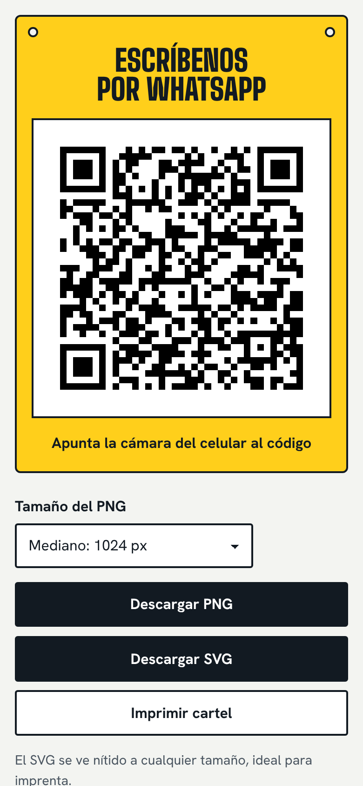
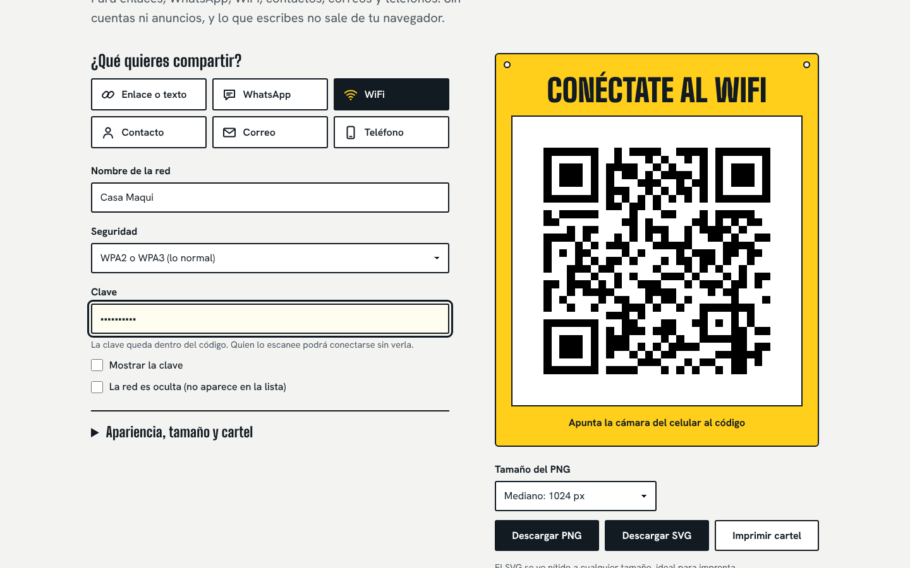
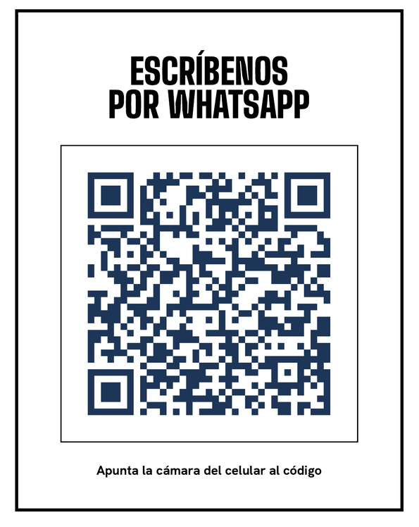

# Generador de códigos QR

Un generador de códigos QR para enlaces, WhatsApp, WiFi, contactos, correos y teléfonos. Corre entero en el navegador: sin cuentas, sin anuncios, sin servidor y sin enviar nada a internet. Descarga el código en PNG o SVG, o imprime un cartel listo para pegar en el mostrador.

**Verlo funcionando:** https://salvadorprogramador.github.io/generador-qr/

El codificador QR está escrito desde cero en JavaScript (`assets/js/qr.js`, unas 400 líneas, sin librerías) y se comprobó contra una librería de referencia y un lector real. Más abajo está el detalle.

| Escritorio | Celular |
| --- | --- |
|  |  |
|  |  |

## Qué hace

- **Seis tipos de código:** enlace o texto, WhatsApp (con mensaje inicial), WiFi (WPA, WEP o abierta, red oculta), contacto (vCard), correo (con asunto y mensaje) y teléfono.
- **Arregla los datos por ti.** Un celular chileno de 9 dígitos recibe el +56. Una dirección sin `https://` se completa. Los caracteres especiales de una clave WiFi se escapan como pide el formato.
- **Descarga en PNG** (512, 1024, 2048 o 4096 px) **o en SVG** (vectorial, nítido a cualquier tamaño). El PNG sale con cuadritos de tamaño exacto, sin bordes borrosos.
- **Cartel imprimible.** El botón «Imprimir cartel» deja en la hoja solo el título y el código, en blanco y negro con marco. Sirve también para guardarlo como PDF.
- **Revisión antes de imprimir.** Avisa si el contraste es bajo, si los colores están invertidos, si el margen es corto y qué tan grande conviene imprimirlo según la cantidad de cuadritos.
- **Colores, margen y nivel de corrección** a elección. El nivel va de baja (7 %) a máxima (30 %).
- Pensado para celular, tableta y escritorio, con navegación por teclado, lector de pantalla y «reducir movimiento».

## Usarlo en tu computador

- **Lo más fácil:** doble clic en `index.html`.
- **Con VS Code:** instala la extensión *Live Server*, clic derecho en `index.html` y *Open with Live Server*.

No hay que instalar ni compilar nada.

## Publicarlo gratis en GitHub Pages

1. En GitHub, crea un repositorio público llamado `generador-qr` y sube todo el contenido de esta carpeta (los archivos y las carpetas, no la carpeta que los contiene).
2. Entra a **Settings → Pages**. En *Build and deployment* deja **Deploy from a branch**, elige la rama `main` y la carpeta `/ (root)`, y guarda.
3. En uno o dos minutos queda en `https://TU-USUARIO.github.io/generador-qr/`.

Si lo publicas con otro usuario o nombre de repositorio, cambia la dirección de `og:image` en `index.html` (es la imagen que aparece al compartir el enlace) y el enlace «Código en GitHub» del encabezado.

## Privacidad y seguridad

- **Lo que escribes no sale de tu navegador.** No hay servidor ni analítica, ni cookies, ni `localStorage`. Al cerrar la pestaña no queda nada guardado.
- **Política de contenido estricta** (`Content-Security-Policy`) dentro de la página: solo se ejecuta código de esta misma carpeta, no se permite ninguna conexión a otros sitios y están desactivados los formularios, los objetos y las ventanas incrustadas.
- **Trusted Types activado:** el navegador bloquea `innerHTML` y cualquier otra forma de meter código por el DOM. Todo lo que se muestra entra como texto. Una prueba escribe HTML y scripts en los campos y comprueba que no se ejecutan.
- **Una clave WiFi dentro de un QR es legible por quien lo escanee.** El código la guarda tal cual para que el celular pueda conectarse. No lo imprimas en un lugar donde no quieras compartir la clave. En pantalla, la clave se enmascara en «Lo que lleva el código».
- **Límite de GitHub Pages:** no deja configurar cabeceras HTTP, por eso la política va dentro de la página. Si necesitas cabeceras completas (HSTS y otras), publica la misma carpeta en Netlify o Cloudflare Pages.

## Cómo se verificó

Un generador de QR que no se puede leer no sirve, así que la comprobación fue lo central del proyecto:

- **Contra una librería de referencia:** 1.120 códigos generados por `qr.js` (versiones 1 a 40, los cuatro niveles de corrección, los tres modos de texto, con el código lleno y a medias, y distintas máscaras) son **idénticos módulo por módulo** a los que produce [segno](https://pypi.org/project/segno/). Salvedad: segno agrega un byte de relleno que la norma no pide, y el script lo corrige antes de comparar.
- **Con un lector real:** 228 códigos, de la versión 1 a la 40, incluidos textos con tildes, `ñ`, emoji y japonés, se leen con [ZXing-C++](https://github.com/zxing-cpp/zxing-cpp) y devuelven exactamente el texto original.
- **Ejemplos clásicos:** «01234567» (versión 1-M, el ejemplo de la norma ISO/IEC 18004) y «HELLO WORLD» (versión 1-Q, el de los tutoriales de referencia) producen exactamente las mismas palabras de datos y de corrección que se publican para ellos.
- **En un navegador real (Chromium):** 79 comprobaciones sobre cada tipo de código, validaciones, descargas, colores, teclado, accesibilidad, «sin JavaScript», entradas hostiles y que no se guarde nada. Los PNG y SVG que se descargan en esas pruebas se leen otra vez con ZXing, y el cartel impreso a PDF también.
- **Lógica:** 17 pruebas con `node --test`.

**Lo que no se probó:** cámaras de celulares reales. Los lectores de las cámaras son parecidos a ZXing, pero **prueba siempre tu código con tu celular antes de imprimir muchas copias**.

### Repetir las pruebas

```bash
node --test                                    # lógica (no instala nada)

pip install segno zxing-cpp pillow numpy       # comparación y lectura
node pruebas/exportar-casos.js
python3 pruebas/verificar-con-librerias.py

npm i playwright && npx playwright install chromium     # navegador
python3 -m http.server 8080                    # en otra terminal, desde esta carpeta
node pruebas/navegador.js
python3 pruebas/decodificar-descargas.py
```

## Lo que no hace

- **No es un QR dinámico.** No cuenta escaneos ni permite cambiar el destino después de impreso. Lo que codificas queda fijo, y por eso nunca vence ni depende de un servicio.
- **No pone logos en el centro ni cambia la forma de los cuadritos.** Ambas cosas reducen la capacidad de lectura y aquí se prioriza que se lea.
- **No genera muchos códigos de una vez** ni guarda un historial.
- **Usa un solo modo de texto por código** (numérico, alfanumérico o bytes). Un texto mezclado puede salir una versión más grande de lo estrictamente necesario. No implementa Kanji, Micro QR ni «structured append».
- **El texto con tildes y emoji va en UTF-8 sin marca ECI.** Lo leen los lectores modernos (cámaras de iPhone y Android, ZXing). Algunos lectores muy antiguos pueden mostrar caracteres raros.

## Estructura

```
index.html            la página
assets/
  js/qr.js            codificador QR (versiones 1 a 40, niveles L M Q H)
  js/payload.js       arma el contenido de cada tipo (WhatsApp, WiFi, vCard…)
  js/color.js         contraste entre colores (WCAG)
  js/main.js          la interfaz
  css/estilo.css      estilos, incluida la hoja de impresión
  img/                ícono e imagen para compartir
  fonts/              Big Shoulders Display y Hanken Grotesk (licencia OFL incluida)
docs/                 capturas de este README
pruebas/              pruebas de lógica, de comparación y de navegador
```

## Licencia

MIT, a nombre de Alexander Carrillo (ver `LICENSE`). Las tipografías Big Shoulders Display y Hanken Grotesk tienen su propia licencia, SIL Open Font License 1.1, incluida en `assets/fonts`.

«QR Code» es una marca registrada de DENSO WAVE INCORPORATED.
