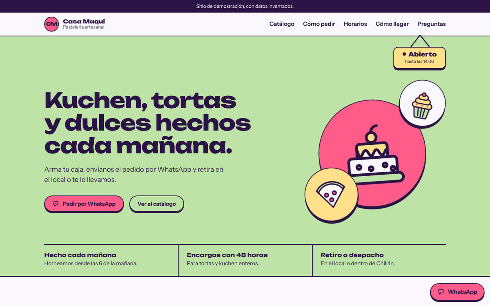
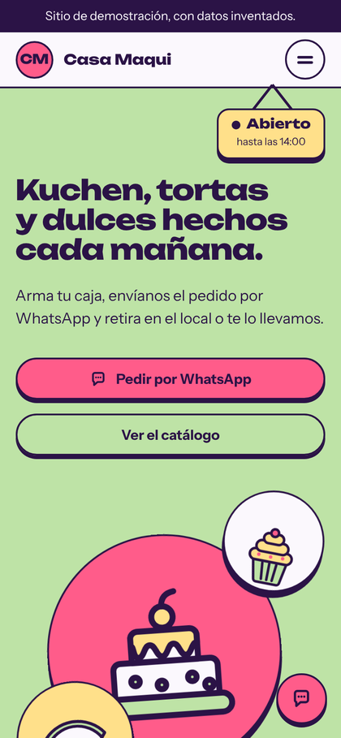
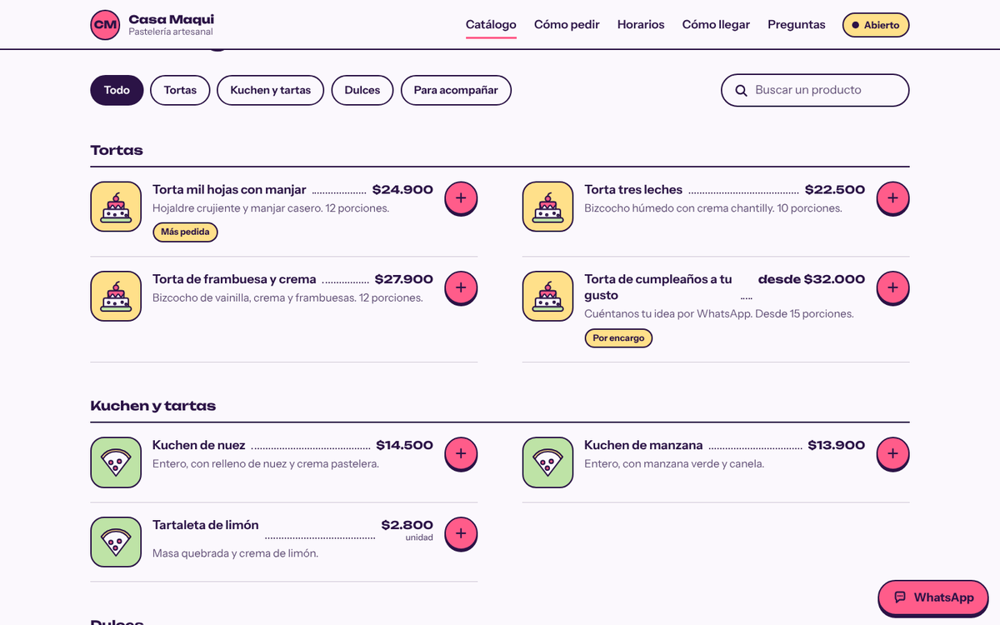
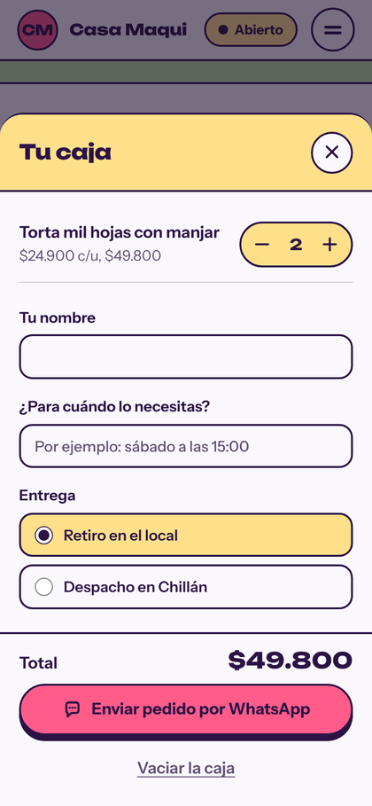

# Sitio modelo para negocios locales

Una página completa para un negocio de barrio: catálogo, pedido por WhatsApp, horario en vivo, cómo llegar y preguntas frecuentes. No usa servidor, base de datos ni herramientas de compilación. Todo el contenido sale de **un solo archivo** (`assets/js/datos.js`), así que cambiar de rubro es cambiar ese archivo.

La demostración está hecha para una pastelería inventada, «Casa Maqui». Sirve igual para una peluquería, un taller, una ferretería o cualquier negocio que venda productos o servicios con precio.

| Escritorio | Celular |
| --- | --- |
|  |  |
|  |  |

## Qué incluye

- **Catálogo tipo carta** con filtros por categoría y buscador (el buscador ignora mayúsculas y tildes).
- **Caja de pedido.** El cliente suma productos, y al enviar se abre WhatsApp con el pedido ya escrito: productos, total, nombre, fecha y tipo de entrega. La caja se recuerda si recarga la página.
- **Letrero «Abierto / Cerrado»** que se calcula con el horario real y la zona horaria del negocio (no la del visitante). También marca el día de hoy en la tabla de horarios y dice cuándo vuelve a abrir.
- **Cómo llegar** con botones a Google Maps y Waze.
- **Colores y fotos propios.** El color del texto sobre cada fondo se elige solo, para que siempre se lea.
- **Pantalla de carga corta** (se puede apagar) y animaciones que respetan «reducir movimiento».
- Pensada para celular, tableta y escritorio, con navegación por teclado y lector de pantalla.

## Verlo en tu computador

- **Lo más fácil:** doble clic en `index.html`.
- **Con VS Code:** instala la extensión *Live Server*, clic derecho en `index.html` y *Open with Live Server*. Se actualiza solo cada vez que guardas.

## Cambiar de rubro

Abre `assets/js/datos.js`. Tiene comentarios que explican cada línea.

1. Cambia `nombre`, `rubro`, `ciudad`, `titular` y `bajada`.
2. Cambia los `colores` (formato `#RRGGBB`).
3. Cambia `categorias` y `productos`. Cada producto lleva `categoria`, `nombre`, `descripcion`, `precio` (solo números) y un `icono`.
4. Cambia `whatsapp`, `direccion`, `horario` y las preguntas frecuentes.

Ejemplo para una peluquería:

```js
nombre: "Peluquería Las Camelias",
rubro: "Peluquería",
colores: { fondo: "#FFF9F5", tinta: "#1F2A44", principal: "#F4C7B8", acento: "#E4572E", suave: "#CFE3F1" },
portada: { iconos: ["tijera", "estrella", "bolsa"], foto: "" },
categorias: [{ id: "corte", nombre: "Cortes" }, { id: "color", nombre: "Color" }],
productos: [
  { categoria: "corte", nombre: "Corte de mujer", descripcion: "Lavado, corte y secado.", precio: 18000, icono: "tijera" },
  { categoria: "color", nombre: "Tintura completa", descripcion: "Según el largo del pelo.", precio: 35000, desde: true, icono: "estrella" }
],
```

Si algo queda mal escrito (un color sin `#`, un precio con puntos, una hora que no existe), al abrir la página en tu computador aparece un **panel de avisos** arriba que dice qué corregir. Los visitantes nunca lo ven.

**Íconos disponibles:** `torta`, `rebanada`, `cupcake`, `galleta`, `pan`, `berlin`, `alfajor`, `taza`, `caja`, `bolsa`, `tijera`, `llave`, `martillo`, `engranaje`, `estrella`, `etiqueta`.

### Fotos

Pon las fotos en `assets/img/` y escribe su ruta en `datos.js`, por ejemplo `foto: "assets/img/torta.webp"`. Sirve en la portada (cuadrada, unos 900 × 900 px) y en cada producto (cuadrada, desde 200 × 200 px). Mejor en formato `.webp` o `.jpg`, y livianas. La foto de la portada reemplaza a los tres íconos.

## Al publicar el sitio real

1. En `datos.js`, cambia `demo: true` por `demo: false`. Se quita la franja de demostración, se publican los datos para Google (horario, dirección, teléfono) y la página deja de estar marcada como «no indexar».
2. En `index.html`, cambia a mano `<title>`, `description`, `og:title`, `og:description` y `og:image`. WhatsApp, Google y las redes leen esas etiquetas antes de ejecutar cualquier programa, por eso no pueden salir de `datos.js`. En `og:image` escribe la dirección completa, por ejemplo `https://tu-dominio.cl/assets/img/og.png`.
3. Reemplaza `assets/img/og.png` (1200 × 630), `favicon.svg` y `apple-touch-icon.png` (180 × 180) por los del negocio.
4. Cambia o borra `creditos`, y **revisa todos los textos de ejemplo**: plazos, medios de pago, alérgenos y preguntas frecuentes. Son inventados y no deben quedar en un negocio real.
5. Si el sitio queda en una subcarpeta (`usuario.github.io/nombre-del-repo`), en `404.html` cambia `/assets` por `/nombre-del-repo/assets`.

## Publicarlo gratis en GitHub Pages

1. En GitHub, crea un repositorio nuevo y sube todo el contenido de esta carpeta (los archivos y la carpeta `assets`, no la carpeta que los contiene).
2. Entra a **Settings → Pages**. En *Build and deployment* deja **Deploy from a branch**, elige la rama `main` y la carpeta `/ (root)`, y guarda.
3. En uno o dos minutos queda en `https://TU-USUARIO.github.io/NOMBRE-DEL-REPO/`.
4. Para usar el dominio del negocio, agrégalo en **Settings → Pages → Custom domain**.

## Seguridad

- **Política de contenido estricta** (`Content-Security-Policy`) dentro de la página: solo se ejecuta código de esta misma carpeta, sin conexiones a servidores externos, y las ventanas incrustadas, formularios y objetos están desactivados.
- **Trusted Types activado:** el navegador bloquea `innerHTML` y cualquier otra forma de meter código por el DOM. La única excepción es una política que escribe los datos para Google, y solo con texto que el propio sitio ya validó.
- **Ningún texto de `datos.js` se interpreta como HTML.** Todo entra como texto. Los números de WhatsApp, colores, rutas de fotos, enlaces, horarios y precios se validan antes de usarse, y los enlaces se arman solo con partes ya revisadas.
- **Sin cookies, sin rastreadores y sin terceros.** Las tipografías están en la misma carpeta. Los enlaces externos abren con `noopener noreferrer`.
- **Todo en `datos.js` es público.** Cualquier visitante puede leer ese archivo, así que no pongas ahí contraseñas ni datos privados.
- **Límite de GitHub Pages:** no deja configurar cabeceras HTTP, por eso la política va dentro de la página. Si el negocio necesita cabeceras completas (HSTS y otras), publica la misma carpeta en Netlify o Cloudflare Pages.

## Lo que no hace

- **No cobra ni guarda pedidos.** El pedido termina en WhatsApp. Pagos en línea, inventario o cuentas de clientes necesitan un servidor y son otro tipo de proyecto.
- **El mapa es un dibujo con botones al mapa real.** No incrusta mapas de terceros, para no cargar código ajeno.
- **No hay panel de administración.** Precios y horarios se cambian en `datos.js`.
- **Sin JavaScript no se ve el catálogo.** Los visitantes ven un aviso para que lo activen o escriban por WhatsApp.

## Estructura

```
index.html            página (las etiquetas para redes y Google se editan a mano al publicar)
404.html              página de error
robots.txt  .nojekyll
assets/
  js/datos.js         ← lo único que se edita para cambiar de rubro
  js/arranque.js      aplica los colores antes de mostrar la página
  js/main.js          arma la página a partir de los datos
  css/estilo.css      estilos
  img/                ícono, imagen para compartir y fotos
  fonts/              Unbounded e Instrument Sans (licencia OFL incluida)
docs/                 capturas de este README
```

## Licencia

MIT, a nombre de Alexander Carrillo (ver `LICENSE`). Los dibujos e íconos son propios. Las tipografías Unbounded e Instrument Sans tienen su propia licencia, SIL Open Font License 1.1, incluida en `assets/fonts`.
